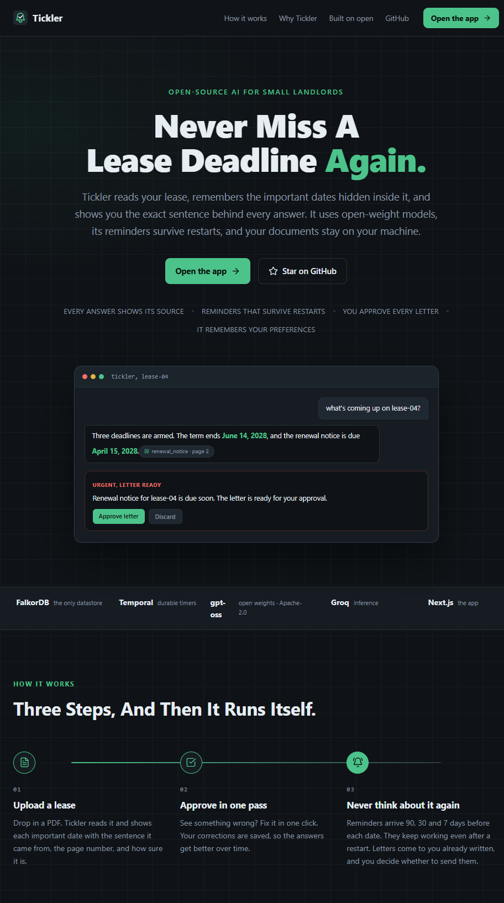
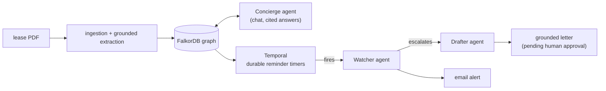
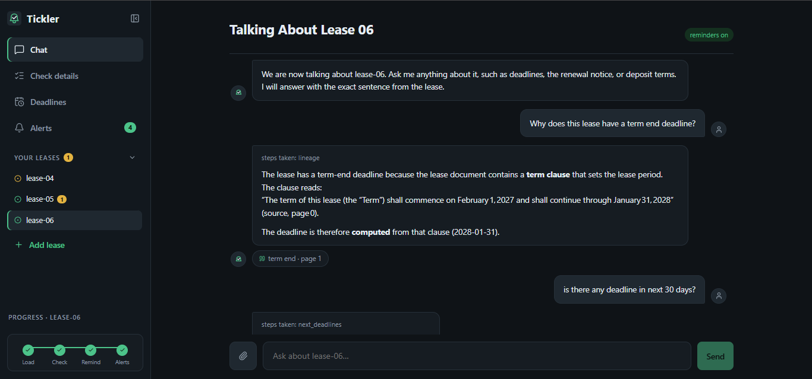
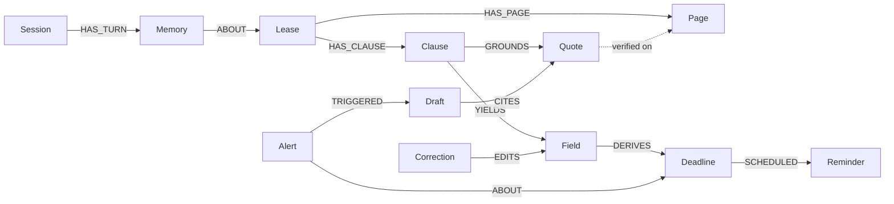

# Tickler: the lease-deadline agent that proves every answer

**Links:** [Repository](https://github.com/abubakar-ahmed-dev/tickler) · [Live demo](https://tickler-web.onrender.com) · [Demo video](VIDEO_LINK)

---

## The date is in there. Good luck finding it.

Every lease document buries its most expensive sentences in prose. "Tenant shall provide written notice of intent to vacate no fewer than sixty (60) days prior to the end of the Term." That sentence is a landmine with a date on it. Miss the window and you can lose a month of rent, inherit an auto-renewal you never wanted, or eat a penalty that was written in plain English the whole time.

Small landlords don't have property managers tracking this. Tenants certainly don't. They have a PDF in a downloads folder and a memory.



Existing tools treat the problem as extract-and-hope: pull the text out of the PDF, hand it to a language model, show the user a table of dates. The model might be right. The model might have invented one of the dates. The user has no way to tell the difference, so a tool that is 95% correct is still useless, because the wrong 5% is exactly the deadline that costs money.

We built Tickler around a different contract: **an answer may only exist if it can be traced, sentence by sentence, to the document.** Every fact lives in a FalkorDB knowledge graph, anchored to the verbatim quote and page it came from, and the product's UI, its agents, and even its reminder emails can walk that chain on demand.

## What Tickler does



1. **Upload a lease.** Tickler parses the PDF page by page and writes the text into the graph. An extraction agent turns prose into structured clauses, fields, and deadlines, using open-weight models (`gpt-oss-20b` and `gpt-oss-120b`, served by Groq, Apache 2.0).
2. **Prove it.** Every extracted claim must cite a verbatim quote that plain code, not the model, verifies exists word-for-word on the cited page. Anything that cannot be proven does not get stored as fact. It gets flagged for human review.
3. **Approve.** The human reviews the abstract: each field next to its source sentence, which opens the actual PDF page with that sentence highlighted. Corrections are recorded as first-class `:Correction` nodes. Deadlines are then computed by a pure function in code, never by the model.
4. **Forget about it.** Approving arms Temporal workflows: 90, 30, and 7 days before each deadline, a reminder fires no matter what. Kill the process mid-wait, restart the machine, the timer still fires. That durability is the point of the product.
5. **Agents take the night shift.** When a reminder fires, a Watcher agent decides: notify, snooze, or escalate. Escalating hands off to a Drafter agent that writes the notice letter grounded only in the lease's own quotes. Drafts are born pending and are sent only if you approve. Alerts also land in your inbox by email.



## Why a graph

We came in knowing we wanted a graph. Building the product confirmed it was the load-bearing decision.

**The core object of this product is a chain, not a row.** A deadline is meaningless without its clause; a clause is meaningless without its quote; a quote is meaningless without its page. That is not tabular data with foreign keys, it is a small ontology, and the product's entire value is the ability to walk it. In FalkorDB, the whole graph looks like this:



The lineage query that powers every "where did this come from?" moment is one readable pattern:

```cypher
MATCH (l:Lease {id:$id})-[:HAS_CLAUSE]->(c:Clause)-[:YIELDS]->(f:Field {key:$key})
OPTIONAL MATCH (c)-[:GROUNDS]->(q:Quote)
RETURN f.key, f.value, c.type, q.text, q.pageIdx
```

One query, whole proof. When the Concierge assistant answers "when does my term end?", it is not allowed to answer from the model's memory at all. Its tools are six MCP functions (`next_deadlines`, `lineage`, `find_lease`, `recall`, `remember`, `request_draft`), and every one of them is a parameterized Cypher query over this graph. Grounding is not a prompt trick here. It is a data structure.

**Everything else in the product wanted to be graph nodes too.** This surprised us. Once the lease graph existed:

- Human corrections became `(:Correction)-[:EDITS]->(:Field)`, so a lease keeps its full history and every agent sees the corrected, human-approved state. There is no cache-invalidation problem, because there is no cache.
- Reminders became `(:Deadline)-[:SCHEDULED]->(:Reminder)`, so arming, firing, and re-arming are queries, not bookkeeping spread across four places.
- Alerts and letters became `(:Alert)-[:ABOUT]->(:Deadline)` and `(:Draft)-[:CITES]->(:Quote)`, so a reminder email's letter can prove its own claims.
- Assistant memory became `(:Session)-[:HAS_TURN]->(:Memory)-[:ABOUT]->(:Lease)`, so the assistant remembers your preferences across conversations.

We kept waiting for the moment we would need a second datastore: a vector database for retrieval, a relational side-car for settings, a queue for agent state. It never came. FalkorDB speaks the Redis protocol, so the entire state of the product is one container, one persistent disk, one client library. Remove FalkorDB and nothing works, by design, and we mean that as a feature: there is no second source of truth to drift out of sync.

**It is fast enough to be conversational.** Every chat turn round-trips through tool calls, and each lineage or deadline query runs in single-digit milliseconds against a full lease graph. The database never appears in the latency budget. The model does, which is where the time should go.

## Making the model prove it

The grounding invariant is the part we are proudest of, and it is the least glamorous code in the repository. After extraction, for every `:Quote`, in plain TypeScript:

```ts
const norm = (s: string) => s.replace(/\s+/g, " ").trim();
const ok = norm(page.text).includes(norm(quote.text));  // verbatim, or it doesn't ship
```

If the check fails, the quote is rejected, the field falls back to `unknown` with a review flag, and the human sees exactly why. The model is good. The check is better. That one loop is why we can put a number on accuracy.

**The numbers:** we generated a corpus of 12 fully synthetic leases (fictional parties, regular prose, real clause shapes: anniversary rent steps, leap-year terms, fixed escalations, deposit windows) with ground truth derived at generation time. Nine were the dev set. Three were sealed as a hold-out that we opened exactly once, after all tuning was frozen.

Extraction results: **99 of 99 fields and every deadline correct on the dev set, 33 of 33 on the sealed hold-out, with every quote verified verbatim by code.** The honest caveat: accuracy is measured on synthetic prose, and real attorney-drafted leases are the next frontier. But the architecture, prove-then-store, is exactly what makes that frontier approachable.

## Timers that survive crashes

A deadline product that can forget is worse than no product at all, so reminders are Temporal workflows, not cron jobs: three durable timer chains per deadline (90, 30, and 7 days out), each firing an activity that runs the Watcher agent. We demo this by literally killing the worker process mid-wait and restarting it. The reminders still land, because Temporal's event history, not our process memory, is the source of truth for what has been scheduled.

The graph holds *what* matters. Temporal holds *when*. Neither is allowed to be the other's problem.

## Shipping the whole stack on Render

The final piece was making it real, not a laptop demo. The entire stack deploys to Render from one blueprint file, [`render.yaml`](../render.yaml):

- **tickler-web**, the Next.js app, as a web service with a persistent disk for uploaded lease PDFs (`UPLOAD_DIR=/data/uploads`), so documents survive redeploys.
- **tickler-falkordb**, FalkorDB as a private service on its own persistent disk. The graph is the whole datastore, and it never leaves the deployment's private network.
- **tickler-temporal**, Temporal's official auto-setup image as a private service, persisted to a managed Postgres instance.
- **tickler-worker**, the reminder runner, as a background worker polling Temporal over the private network.

```yaml
- type: pserv
  name: tickler-falkordb
  runtime: image
  image:
    url: docker.io/falkordb/falkordb:latest
  disk:
    name: tickler-graph
    mountPath: /data
    sizeGB: 1
```

That block is the entire database deployment. One file provisions everything, and secrets are requested once at creation, which means the project reproduces from the repository in about ten minutes.

You can try the result at [tickler-web.onrender.com](https://tickler-web.onrender.com): load a sample lease, open Check details, and click "View in PDF" on any field. The viewer renders the actual page with your quoted sentence highlighted. That button is the product thesis in one interaction.

## What we learned

- **Model the state first; the features follow.** Deciding that process state, agent memory, and corrections all live in one graph deleted entire categories of plumbing. The features we are proudest of (lineage on click, letters that cite themselves) were cheap because the graph was already there.
- **Verify in code what you would be tempted to prompt.** "Always cite the source" is a suggestion. A substring check is a guarantee. The gap between those two is most of the distance between a demo and a product.
- **Durability is a product feature, not infrastructure.** The kill-the-worker demo is the most convincing twenty seconds of our video, and it exists because we chose a workflow engine over a scheduler early.
- **Open weights were enough.** Both agents and the extractor run on gpt-oss (Apache 2.0) via Groq: structured outputs, tool calls, drafting quality. No closed model anywhere in the pipeline, which mattered to us for a document-sensitive product.

Tickler reads, reminds, and drafts. The human decides. The graph remembers everything.

**Try it:** [tickler-web.onrender.com](https://tickler-web.onrender.com) · **Code:** [github.com/abubakar-ahmed-dev/tickler](https://github.com/abubakar-ahmed-dev/tickler) · **Video:** [VIDEO_LINK]

*Disclosure: this post was drafted with AI assistance and engineered, fact-checked, and shipped by the Tickler team.*
